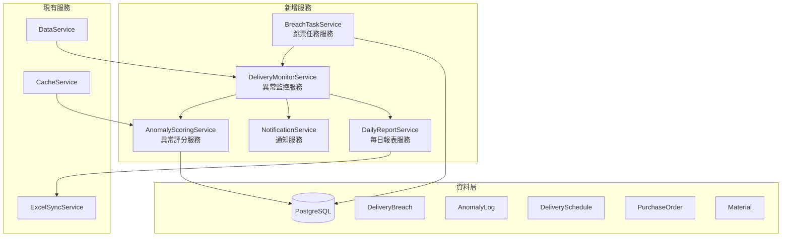
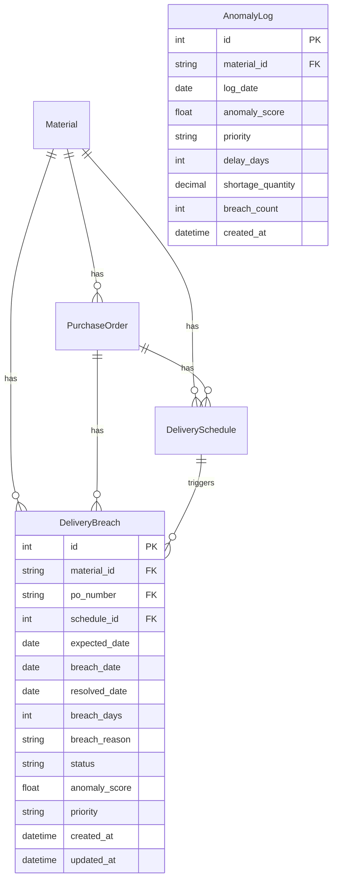

# 採購儀表板智慧化管理功能規劃 - 實施建議

## 文件版本資訊
- **版本**: 1.0.0
- **建立日期**: 2026-06-08
- **作者**: 系統架構規劃
- **依據**: 採購儀表板智慧化管理功能規劃.md (v1.0.0)
- **目標**: 根據現有系統架構提供完整詳細的實施建議

---

## 一、現有系統架構分析

### 1.1 技術堆疊
| 層級 | 技術 | 版本/框架 |
|------|------|-----------|
| 後端框架 | Flask | Python Web Framework |
| 資料庫 | PostgreSQL + SQLAlchemy | ORM |
| 快取服務 | 記憶體快取 (cache_manager) | 自訂實作 |
| 前端 | 原生 HTML/JS | 無框架 |
| Excel 處理 | openpyxl / pandas | Python 套件 |
| 部署方式 | 待確認 (systemd/gunicorn) | - |

### 1.2 現有目錄結構
```
app/
├── controllers/          # 控制器層
│   ├── api_controller.py      # API 端點 (2060 行，包含現有 API)
│   ├── page_controller.py     # 頁面路由
│   ├── auth_controller.py     # 認證控制器
│   └── api_controller_part.py # API 片段
├── models/              # 資料模型層
│   ├── database.py             # SQLAlchemy 模型 (366 行，10 個模型)
│   ├── material.py             # Material DAO
│   ├── order.py                # Order DAO
│   └── traffic.py              # Traffic DAO
├── services/            # 業務邏輯層
│   ├── cache_service.py          # 快取管理
│   ├── data_service.py           # 資料服務
│   ├── excel_sync_service.py     # Excel 同步
│   ├── receipt_sync_service.py   # 收據同步
│   ├── spec_service.py           # 規格服務
│   ├── traffic_service.py        # 流量服務
│   └── work_order_stats_service.py # 工單統計
├── views/               # 頁面模板
│   └── procurement.html            # 採購儀表板 (390 行)
└── static/js/           # 前端 JS
    └── modules/procurement-dashboard.js  # 採購儀表板模組
```

### 1.3 現有資料庫模型
| 模型 | 資料表 | 用途 |
|------|--------|------|
| User | users | 使用者/採購人員 |
| Material | materials | 物料主檔 |
| Order | orders | 訂單主檔 |
| OrderMaterial | order_materials | 訂單物料需求 |
| PurchaseOrder | purchase_orders | 採購訂單 |
| OrderSpec | order_specs | 訂單規格 |
| DeliveryUpdate | delivery_updates | 交期更新記錄 |
| DeliverySchedule | delivery_schedules | 交期分批排程 |
| ComponentRequirement | component_requirements | 成品組件需求 |
| PartDrawingMapping | part_drawing_mappings | 品號-圖號對照 |
| SubstituteNotification | substitute_notifications | 替代品通知 |
| CastingOrder | casting_orders | 鑄件訂單 |

### 1.4 現有 API 端點分類
| 類別 | 端點 | 數量 |
|------|------|------|
| 物料資料 | /api/materials, /api/finished_materials | 2 |
| 物料詳情 | /api/material/*/details, /api/material/*/buyer_reference | 2 |
| 交期管理 | /api/delivery/*, /api/delivery/batch-clear-overdue | 7 |
| 採購單 | /api/purchase_orders/*, /api/purchase_orders/open | 5 |
| 圖號對照 | /api/part-drawing/* | 7 |
| 替代品通知 | /api/substitute_notification/* | 4 |
| 組件需求 | /api/component_requirements/* | 5 |
| 工單統計 | /api/work-order-statistics/* | 5 |
| 資料同步 | /api/sync/* | 2 |

---

## 二、功能需求分析與現況對比

### 2.1 規劃文件需求 vs 現有系統

| 功能需求 | 規劃文件內容 | 現有系統支援度 | 差距分析 |
|----------|-------------|---------------|----------|
| **跳票記錄** | DeliveryBreach 模型 | ❌ 完全缺失 | 需新增模型、資料表、邏輯 |
| **異常評分** | AnomalyScoringService | ❌ 完全缺失 | 需新增服務與演算法 |
| **異常警示區** | 浮動警示組件 | ❌ 完全缺失 | 需新增前端元件 |
| **異常追蹤頁籤** | 新增頁籤 | ❌ 完全缺失 | 需新增前端頁面 |
| **每日變動報表** | ReportService | ❌ 完全缺失 | 需新增服務與匯出功能 |
| **自動通知機制** | NotificationService | ❌ 完全缺失 | 需新增通知系統 |
| **定時任務** | 跳票檢查腳本 | ❌ 完全缺失 | 需新增排程系統 |
| **統計圖卡** | 8 項統計圖卡 | ✅ 已實作 | procurement.html 已有統計卡 |
| **交期管理** | DeliverySchedule | ✅ 已實作 | 已有分批交期功能 |
| **異常篩選** | 優先級/類型篩選 | ❌ 缺失 | 需新增篩選邏輯 |

### 2.2 關鍵發現
1. **統計圖卡已部分實作**：現有 `procurement.html` 已有 10 個統計圖卡，包含「交貨延期」、「需求逾期欠料」等關鍵指標
2. **DeliverySchedule 已存在**：分批交期功能已實作，可直接用於跳票檢查
3. **PurchaseOrder 已有 status 欄位**：可擴充用於跳票狀態追蹤
4. **快取架構已完善**：`cache_manager` 可作為異常資料的快取層

---

## 三、資料庫模型實施建議

### 3.1 需新增的模型

#### 3.1.1 DeliveryBreach (跳票記錄表)
```python
class DeliveryBreach(db.Model):
    """交期跳票記錄 - 追蹤每次交期延誤的詳細資訊"""
    __tablename__ = 'delivery_breaches'
    
    id = db.Column(db.Integer, primary_key=True)
    material_id = db.Column(db.String(50), db.ForeignKey('materials.material_id'), nullable=False, index=True)
    po_number = db.Column(db.String(50), db.ForeignKey('purchase_orders.po_number'), nullable=True, index=True)
    schedule_id = db.Column(db.Integer, db.ForeignKey('delivery_schedules.id'), nullable=True, index=True)
    
    # 跳票核心資訊
    expected_date = db.Column(db.Date, nullable=False)          # 原預計交期
    breach_date = db.Column(db.Date, nullable=False)            # 跳票發生日期
    resolved_date = db.Column(db.Date, nullable=True)           # 解決日期（實際入庫日）
    breach_days = db.Column(db.Integer, default=0)              # 跳票天數
    breach_reason = db.Column(db.String(200))                   # 跳票原因
    
    # 評分相關
    anomaly_score = db.Column(db.Float, default=0)              # 異常評分 (0-100)
    priority = db.Column(db.String(20), default='normal')       # 優先級
    
    # 狀態
    status = db.Column(db.String(20), default='active')         # active, resolved, cancelled
    
    # 系統欄位
    created_at = db.Column(db.DateTime, default=get_taiwan_time)
    updated_at = db.Column(db.DateTime, default=get_taiwan_time, onupdate=get_taiwan_time)
```

**索引建議**：
```python
__table_args__ = (
    db.Index('idx_breach_material_status', 'material_id', 'status'),
    db.Index('idx_breach_priority', 'priority', 'status'),
    db.Index('idx_breach_breach_date', 'breach_date', 'status'),
)
```

#### 3.1.2 AnomalyLog (異常日誌表)
```python
class AnomalyLog(db.Model):
    """異常日誌 - 記錄每日異常狀態變化，用於趨勢分析"""
    __tablename__ = 'anomaly_logs'
    
    id = db.Column(db.Integer, primary_key=True)
    material_id = db.Column(db.String(50), nullable=False, index=True)
    log_date = db.Column(db.Date, nullable=False, index=True)
    
    # 當日狀態快照
    anomaly_score = db.Column(db.Float, default=0)
    priority = db.Column(db.String(20))
    delay_days = db.Column(db.Integer, default=0)
    shortage_quantity = db.Column(db.Numeric(15, 3), default=0)
    breach_count = db.Column(db.Integer, default=0)
    
    # 系統欄位
    created_at = db.Column(db.DateTime, default=get_taiwan_time)
    
    __table_args__ = (
        db.Index('idx_anomaly_material_date', 'material_id', 'log_date'),
    )
```

### 3.2 需擴充的現有模型

#### 3.2.1 Material 模型擴充
```python
# 在 Material 模型中新增：
breaches = db.relationship('DeliveryBreach', back_populates='material', 
                           cascade='all, delete-orphan', 
                           foreign_keys='DeliveryBreach.material_id')

@property
def active_breach_count(self):
    """當前未解決的跳票次數"""
    return db.session.query(func.count(DeliveryBreach.id)).filter(
        DeliveryBreach.material_id == self.material_id,
        DeliveryBreach.status == 'active'
    ).scalar()

@property
def max_breach_days(self):
    """最大跳票天數"""
    breach = db.session.query(DeliveryBreach).filter(
        DeliveryBreach.material_id == self.material_id,
        DeliveryBreach.status == 'active'
    ).order_by(DeliveryBreach.breach_days.desc()).first()
    return breach.breach_days if breach else 0
```

#### 3.2.2 PurchaseOrder 模型擴充
```python
# 在 PurchaseOrder 模型中新增：
breaches = db.relationship('DeliveryBreach', back_populates='purchase_order',
                           cascade='all, delete-orphan',
                           foreign_keys='DeliveryBreach.po_number')

@property
def total_breach_count(self):
    """總跳票次數"""
    return db.session.query(func.count(DeliveryBreach.id)).filter(
        DeliveryBreach.po_number == self.po_number
    ).scalar()
```

#### 3.2.3 DeliverySchedule 模型擴充
```python
# 在 DeliverySchedule 模型中新增：
breaches = db.relationship('DeliveryBreach', back_populates='delivery_schedule',
                           cascade='all, delete-orphan')

@property
def is_overdue(self):
    """是否已過期"""
    from datetime import date
    return self.expected_date < date.today() and self.status not in ['completed', 'cancelled']

@property
def overdue_days(self):
    """過期天數"""
    from datetime import date
    if self.is_overdue:
        return (date.today() - self.expected_date).days
    return 0
```

---

## 四、服務層架構設計建議

### 4.1 服務模組架構圖



### 4.2 服務詳細設計

#### 4.2.1 AnomalyScoringService (異常評分服務)

**設計原則**：
- 評分計算放在**後端**（確保一致性）
- 快取計算結果（避免重複計算）
- 支援權重調整（不需修改程式碼）

```python
# app/services/anomaly_scoring_service.py

class AnomalyScoringService:
    """異常評分服務"""
    
    # 可配置權重 (建議從資料庫或設定檔讀取)
    WEIGHTS = {
        'delay_days': 0.35,        # 延遲天數權重
        'shortage_quantity': 0.25, # 缺料數量權重
        'production_impact': 0.25, # 生產影響權重
        'breach_history': 0.15     # 跳票歷史權重
    }
    
    @classmethod
    def calculate_anomaly_score(cls, material_id, current_data=None):
        """
        計算物料異常評分（0-100 分，分數越高越緊急）
        
        使用快取減少資料庫查詢
        """
        # 檢查快取
        cache_key = f'anomaly_score:{material_id}'
        cached = cache_manager.get(cache_key)
        if cached:
            return cached
        
        # 計算評分邏輯
        result = cls._calculate(material_id)
        
        # 儲存到快取 (5 分鐘有效)
        cache_manager.set(cache_key, result, expire=300)
        
        return result
    
    @classmethod
    def _calculate(cls, material_id):
        """實際評分計算"""
        # 1. 取得相關資料
        material_data = cls._get_material_data(material_id)
        delivery_data = cls._get_delivery_data(material_id)
        demand_data = cls._get_demand_data(material_id)
        breach_data = cls._get_breach_data(material_id)
        
        # 2. 計算各維度得分
        delay_score = cls._calc_delay_score(delivery_data)
        shortage_score = cls._calc_shortage_score(material_data)
        production_score = cls._calc_production_impact(demand_data)
        history_score = cls._calc_breach_history(breach_data)
        
        # 3. 加權總分
        total = (
            delay_score * cls.WEIGHTS['delay_days'] +
            shortage_score * cls.WEIGHTS['shortage_quantity'] +
            production_score * cls.WEIGHTS['production_impact'] +
            history_score * cls.WEIGHTS['breach_history']
        )
        
        return {
            'score': round(min(100, total), 2),
            'breakdown': {
                'delay_days': delay_score,
                'shortage_quantity': shortage_score,
                'production_impact': production_score,
                'breach_history': history_score
            },
            'priority': cls._get_priority(min(100, total))
        }
```

**評分閾值建議**：
| 優先級 | 評分範圍 | 顏色 | 處理時間 | 通知對象 |
|--------|----------|------|----------|----------|
| Critical | 80-100 | #f44336 (紅) | 立即 | 主管 + 採購 |
| High | 60-79 | #ff9800 (橘) | 24 小時 | 採購 |
| Medium | 40-59 | #ffeb3b (黃) | 3 天 | 採購 |
| Low | 20-39 | #fff176 (淺黃) | 1 週 | 採購 |
| Normal | 0-19 | #4caf50 (綠) | 常規 | - |

#### 4.2.2 DeliveryMonitorService (異常監控服務)

```python
# app/services/delivery_monitor_service.py

class DeliveryMonitorService:
    """異常監控服務 - 管理所有異常相關操作"""
    
    @classmethod
    def get_current_anomalies(cls, filters=None):
        """
        取得當前異常清單 (供 API 使用)
        
        filters:
            - priority: 優先級篩選
            - type: 異常類型 (delayed/breach/shortage)
            - page/per_page: 分頁
            - buyer_id: 採購人員篩選
        """
        # 查詢 active 的跳票記錄
        # 連線異常評分
        # 回傳格式化資料
        pass
    
    @classmethod
    def get_alert_data(cls):
        """取得異常警示區顯示資料"""
        # 統計各優先級數量
        # 取得前 10 個最高分項目
        pass
    
    @classmethod
    def get_breaches(cls, filters=None):
        """取得跳票記錄清單"""
        pass
    
    @classmethod
    def update_breach(cls, breach_id, data):
        """更新跳票記錄 (解決、填寫原因等)"""
        pass
```

#### 4.2.3 DailyReportService (每日報表服務)

```python
# app/services/daily_report_service.py

class DailyReportService:
    """每日變動報表服務"""
    
    @classmethod
    def generate_daily_report(cls, date=None):
        """生成每日變動報表"""
        report_date = date or date.today()
        
        return {
            'report_date': report_date,
            'summary': {
                'new_breaches': count,
                'resolved_breaches': count,
                'score_changes': count,
                'delivery_updates': count
            },
            'details': {
                'new_breaches': [...],
                'resolved_breaches': [...],
                'score_changes': [...]
            }
        }
    
    @classmethod
    def export_to_excel(cls, report_data):
        """匯出為 Excel"""
        # 使用 openpyxl 建立多 sheet 檔案
        # Sheet 1: 摘要
        # Sheet 2: 新增跳票
        # Sheet 3: 解決跳票
        # Sheet 4: 評分變化
        pass
    
    @classmethod
    def record_daily_snapshot(cls, date=None):
        """記錄每日異常狀態快照 (用於趨勢分析)"""
        # 將所有物料的異常狀態寫入 AnomalyLog
        pass
```

#### 4.2.4 NotificationService (通知服務)

```python
# app/services/notification_service.py

class NotificationService:
    """通知服務 - 管理各種通知機制"""
    
    @classmethod
    def check_and_notify(cls, material_id, score_result):
        """檢查並發送通知"""
        score = score_result['score']
        priority = score_result['priority']
        
        notifications = []
        
        # 極高優先級通知
        if score >= 80:
            notifications.append(cls._create_critical_alert(material_id, score))
        
        # 評分大幅變化通知
        prev_score = cls._get_previous_score(material_id)
        if prev_score and (score - prev_score) >= 20:
            notifications.append(cls._create_score_jump_alert(material_id, score, prev_score))
        
        # 發送通知
        for notification in notifications:
            cls._send(notification)
        
        return notifications
    
    @classmethod
    def _send(cls, notification):
        """發送通知"""
        # 選項 1: 前端即時通知 (WebSocket - 未來擴充)
        # 選項 2: 頁面載入時顯示 (目前實作方式)
        # 選項 3: 郵件通知 (未來擴充)
        pass
```

#### 4.2.5 BreachTaskService (跳票任務服務)

```python
# app/services/breach_task_service.py

class BreachTaskService:
    """跳票任務服務 - 處理定時任務邏輯"""
    
    @classmethod
    def check_overdue_deliveries(cls):
        """
        檢查並記錄跳票事件
        
        執行頻率：每天 08:00
        邏輯：
        1. 找出所有已過期但未完成的交期排程
        2. 檢查是否已有 active 的跳票記錄
        3. 若無，則新增跳票記錄
        4. 若有，則更新延遲天數
        """
        today = date.today()
        
        overdue_schedules = DeliverySchedule.query.filter(
            DeliverySchedule.expected_date < today,
            DeliverySchedule.status.notin_(['completed', 'cancelled'])
        ).all()
        
        for schedule in overdue_schedules:
            existing = DeliveryBreach.query.filter(
                DeliveryBreach.schedule_id == schedule.id,
                DeliveryBreach.status == 'active'
            ).first()
            
            if existing:
                existing.breach_days = (today - schedule.expected_date).days
                existing.updated_at = get_taiwan_time()
            else:
                breach = DeliveryBreach(
                    material_id=schedule.material_id,
                    po_number=schedule.po_number,
                    schedule_id=schedule.id,
                    expected_date=schedule.expected_date,
                    breach_date=today,
                    breach_days=(today - schedule.expected_date).days,
                    status='active'
                )
                db.session.add(breach)
        
        db.session.commit()
    
    @classmethod
    def check_resolution(cls):
        """
        檢查跳票是否已解決
        
        執行頻率：每天 22:00
        邏輯：檢查已完成入庫的交期，標記對應跳票為 resolved
        """
        pass
```

---

## 五、API 端點設計建議

### 5.1 API 路由規劃

```
新增 API 端點 (相對於現有 /api/ 前綴):

異常監控:
├── GET  /api/anomalies/current           # 取得當前異常清單
├── GET  /api/anomalies/alert-data        # 取得警示區資料
├── GET  /api/anomalies/score/<material_id> # 取得特定物料評分
└── GET  /api/anomalies/history           # 取得異常歷史

跳票管理:
├── GET  /api/breaches                    # 取得跳票記錄清單
├── GET  /api/breaches/<int:id>           # 取得單一跳票記錄
├── PUT  /api/breaches/<int:id>           # 更新跳票記錄
└── POST /api/breaches/<int:id>/resolve   # 標記為已解決

報表:
├── GET  /api/reports/daily               # 取得每日報表
├── GET  /api/reports/daily/export        # 匯出每日報表 Excel
└── GET  /api/reports/trend               # 取得異常趨勢資料

任務:
├── POST /api/tasks/check-breaches        # 手動觸發跳票檢查
└── GET  /api/tasks/status                # 取得定時任務狀態
```

### 5.2 API 回應格式範例

#### GET /api/anomalies/current
```json
{
    "success": true,
    "data": {
        "total": 45,
        "page": 1,
        "per_page": 50,
        "summary": {
            "critical": 5,
            "high": 12,
            "medium": 18,
            "low": 10
        },
        "items": [
            {
                "material_id": "MAT-001234",
                "description": "鋼板 5mm",
                "score": 92.5,
                "priority": "critical",
                "delay_days": 15,
                "shortage_quantity": 5000,
                "breach_count": 3,
                "buyer": "王小明",
                "po_number": "PO-2026-001",
                "last_updated": "2026-06-08 08:00:00"
            }
        ]
    }
}
```

#### GET /api/anomalies/alert-data
```json
{
    "success": true,
    "data": {
        "critical_count": 5,
        "high_count": 12,
        "medium_count": 18,
        "show_alert": true,
        "top_items": [
            {
                "material_id": "MAT-001234",
                "score": 92.5,
                "priority": "critical",
                "delay_days": 15,
                "shortage_quantity": 5000
            }
        ]
    }
}
```

---

## 六、前端元件架構設計

### 6.1 現有前端結構分析

| 檔案 | 用途 | 建議 |
|------|------|------|
| procurement.html | 主頁面 | 新增警示區 + 異常追蹤頁籤 |
| procurement-dashboard.js | 儀表板邏輯 | 擴充異常相關功能 |
| api-service.js | API 呼叫封裝 | 新增異常 API 方法 |
| modals.css | Modal 樣式 | 擴充警示相關樣式 |

### 6.2 新增前端檔案清單

```
app/static/
├── css/
│   └── components/
│       └── anomaly-alert.css          # 異常警示區樣式
└── js/
    ├── services/
    │   └── anomaly-service.js         # 異常 API 呼叫服務
    ├── utils/
    │   └── anomaly-utils.js           # 異常工具函數 (評分顯示等)
    └── modules/
        └── anomaly-alert-widget.js    # 異常警示區元件
```

### 6.3 異常警示區設計

**位置**：固定在採購儀表板右上角

**顯示條件**：
- `critical_count > 0` 或 `high_count > 0` 時顯示
- 無異常時自動隱藏

**互動設計**：
1. 點擊警示區可展開完整清單
2. 點擊異常項目可跳轉到物料詳情 Modal
3. 每 5 分鐘自動更新
4. 可手動dismiss（暫時關閉）

**UI 結構**：
```html
<!-- 新增於 procurement.html，統計圖卡下方 -->
<div id="anomaly-alert-section" class="anomaly-alert-section" style="display: none;">
    <div class="alert-header">
        <h3>⚠️ 異常警示</h3>
        <button class="dismiss-btn">✖</button>
    </div>
    <div class="alert-summary">
        <div class="alert-stat critical">
            <span class="stat-value" id="critical-count">0</span>
            <span class="stat-label">極高優先級</span>
        </div>
        <div class="alert-stat high">
            <span class="stat-value" id="high-count">0</span>
            <span class="stat-label">高優先級</span>
        </div>
        <div class="alert-stat medium">
            <span class="stat-value" id="medium-count">0</span>
            <span class="stat-label">中優先級</span>
        </div>
    </div>
    <div class="alert-list" id="alert-list">
        <!-- 動態載入 -->
    </div>
    <div class="alert-footer">
        <a href="#tab-anomaly-tracking" class="view-all-link">查看全部異常 →</a>
    </div>
</div>
```

### 6.4 異常追蹤頁籤設計

**位置**：新增於現有頁籤導覽

**頁籤結構**：
```html
<nav id="dashboard-tabs-nav">
    <ul>
        <li><a href="#" class="dashboard-tab-link active" data-tab="tab-main-dashboard">半品儀表板</a></li>
        <li><a href="#" class="dashboard-tab-link" data-tab="tab-finished-dashboard">成品儀表板</a></li>
        <li><a href="#" class="dashboard-tab-link" data-tab="tab-anomaly-tracking">異常追蹤 <span id="anomaly-badge" class="badge" style="display:none;">0</span></a></li>
    </ul>
</nav>

<div id="tab-anomaly-tracking" class="dashboard-tab-content" style="display:none;">
    <!-- 篩選控制 -->
    <div class="anomaly-filters">
        <select id="filter-priority">
            <option value="all">所有優先級</option>
            <option value="critical">極高優先級</option>
            <option value="high">高優先級</option>
            <option value="medium">中優先級</option>
            <option value="low">低優先級</option>
        </select>
        
        <select id="filter-type">
            <option value="all">所有類型</option>
            <option value="delayed">交期延遲</option>
            <option value="breach">交期跳票</option>
            <option value="shortage">嚴重缺料</option>
        </select>
        
        <select id="filter-buyer">
            <option value="">所有採購人員</option>
            <!-- 動態載入 -->
        </select>
        
        <button id="refresh-anomalies-btn">🔄 重新整理</button>
        <button id="export-report-btn">📊 匯出報表</button>
    </div>
    
    <!-- 異常清單表格 -->
    <table class="anomaly-table">
        <thead>
            <tr>
                <th>優先級</th>
                <th>物料編號</th>
                <th>物料說明</th>
                <th>異常評分</th>
                <th>延遲天數</th>
                <th>缺料數量</th>
                <th>跳票次數</th>
                <th>採購人員</th>
                <th>採購單號</th>
                <th>操作</th>
            </tr>
        </thead>
        <tbody id="anomaly-table-body">
            <!-- 動態載入 -->
        </tbody>
    </table>
    
    <!-- 跳票歷史 -->
    <details style="margin-top: 2em;">
        <summary>📜 跳票歷史記錄</summary>
        <table class="breach-history-table">
            <thead>
                <tr>
                    <th>發生日期</th>
                    <th>物料編號</th>
                    <th>採購單號</th>
                    <th>原交期</th>
                    <th>跳票天數</th>
                    <th>解決日期</th>
                    <th>狀態</th>
                </tr>
            </thead>
            <tbody id="breach-history-body">
                <!-- 動態載入 -->
            </tbody>
        </table>
    </details>
</div>
```

### 6.5 前端服務模組

```javascript
// app/static/js/services/anomaly-service.js

const AnomalyService = {
    /**
     * 取得警示區資料
     */
    async getAlertData() {
        const response = await fetch('/api/anomalies/alert-data');
        return response.json();
    },
    
    /**
     * 取得異常清單
     */
    async getAnomalies(filters = {}) {
        const params = new URLSearchParams({
            priority: filters.priority || 'all',
            type: filters.type || 'all',
            page: filters.page || 1,
            per_page: filters.per_page || 50
        });
        
        const response = await fetch(`/api/anomalies/current?${params}`);
        return response.json();
    },
    
    /**
     * 取得特定物料評分
     */
    async getMaterialScore(materialId) {
        const response = await fetch(`/api/anomalies/score/${materialId}`);
        return response.json();
    },
    
    /**
     * 取得跳票記錄
     */
    async getBreaches(filters = {}) {
        const params = new URLSearchParams(filters);
        const response = await fetch(`/api/breaches?${params}`);
        return response.json();
    },
    
    /**
     * 標記跳票為已解決
     */
    async resolveBreach(breachId) {
        const response = await fetch(`/api/breaches/${breachId}/resolve`, {
            method: 'POST'
        });
        return response.json();
    }
};

window.AnomalyService = AnomalyService;
```

---

## 七、定時任務設計

### 7.1 任務清單

| 任務 | 頻率 | 執行時間 | 說明 |
|------|------|----------|------|
| 跳票檢查 | 每天 | 08:00 | 檢查並記錄新的跳票 |
| 解決檢查 | 每天 | 22:00 | 檢查已解決的跳票 |
| 評分更新 | 每天 | 08:30 | 更新所有異常物料的評分 |
| 每日快照 | 每天 | 09:00 | 記錄每日異常狀態 |

### 7.2 實作方式建議

#### 選項 A：系統 Crontab (推薦用於生產環境)
```bash
# /etc/cron.d/procurement-monitor

# 每天早上 8:00 檢查跳票
0 8 * * * cd /path/to/app && /usr/bin/python app/tasks/breach_checker.py >> /var/log/procurement/breach_check.log 2>&1

# 每天晚上 22:00 檢查跳票解決
0 22 * * * cd /path/to/app && /usr/bin/python app/tasks/breach_resolver.py >> /var/log/procurement/breach_resolve.log 2>&1

# 每天早上 9:00 生成每日快照
0 9 * * * cd /path/to/app && /usr/bin/python app/tasks/daily_snapshot.py >> /var/log/procurement/daily_snapshot.log 2>&1
```

#### 選項 B：Flask-APScheduler (推薦用於開發/測試)
```python
# app/tasks/scheduler.py

from flask_apscheduler import APScheduler

def init_scheduler(app):
    scheduler = APScheduler()
    scheduler.init_app(app)
    scheduler.start()
    
    # 每天 8:00 執行跳票檢查
    scheduler.add_job(
        id='check_breaches',
        func='app.tasks.breach_checker:check_overdue_deliveries',
        trigger='cron',
        hour=8,
        minute=0
    )
    
    # 每天 22:00 執行解決檢查
    scheduler.add_job(
        id='check_resolution',
        func='app.tasks.breach_resolver:check_resolutions',
        trigger='cron',
        hour=22,
        minute=0
    )
```

#### 選項 C：API 手動觸發 (開發階段使用)
```python
# 新增 API 端點供管理員手動觸發
@api_bp.route('/tasks/check-breaches', methods=['POST'])
def manual_check_breaches():
    from app.services.breach_task_service import BreachTaskService
    BreachTaskService.check_overdue_deliveries()
    return jsonify({'success': True, 'message': '跳票檢查已完成'})
```

**建議**：開發階段使用 **選項 C**，生產環境使用 **選項 A**。

---

## 八、實施階段規劃

### 階段 1：資料庫基礎 (優先級：高)
| 項目 | 內容 | 產出 |
|------|------|------|
| 1.1 | 建立 DeliveryBreach 模型 | 新增模型定義 |
| 1.2 | 建立 AnomalyLog 模型 | 新增模型定義 |
| 1.3 | 擴充 Material/PurchaseOrder/DeliverySchedule | 新增關聯與屬性 |
| 1.4 | 建立資料庫遷移腳本 | tools/migrate_breach_model.py |
| 1.5 | 驗證資料庫結構 | 測試確認 |

### 階段 2：核心服務 (優先級：高)
| 項目 | 內容 | 產出 |
|------|------|------|
| 2.1 | 實作 AnomalyScoringService | 評分服務模組 |
| 2.2 | 實作 BreachTaskService | 跳票任務服務 |
| 2.3 | 實作 DeliveryMonitorService 核心方法 | 監控服務模組 |
| 2.4 | 單元測試 | 測試腳本 |

### 階段 3：API 端點 (優先級：高)
| 項目 | 內容 | 產出 |
|------|------|------|
| 3.1 | 實作異常監控 API | 4 個 API 端點 |
| 3.2 | 實作跳票管理 API | 4 個 API 端點 |
| 3.3 | 實作報表 API | 2 個 API 端點 |
| 3.4 | API 測試 | 測試確認 |

### 階段 4：前端元件 (優先級：中)
| 項目 | 內容 | 產出 |
|------|------|------|
| 4.1 | 實作異常警示區 | CSS + JS 元件 |
| 4.2 | 實作異常追蹤頁籤 | HTML + JS |
| 4.3 | 實作前端服務模組 | anomaly-service.js |
| 4.4 | 整合測試 | UI 測試 |

### 階段 5：通知與報表 (優先級：低)
| 項目 | 內容 | 產出 |
|------|------|------|
| 5.1 | 實作 DailyReportService | 報表服務 |
| 5.2 | 實作通知服務 | 通知服務 |
| 5.3 | 設定定時任務 | 排程配置 |
| 5.4 | 完整測試 | 端到端測試 |

---

## 九、風險與注意事項

### 9.1 技術風險

| 風險 | 影響 | 緩解措施 |
|------|------|----------|
| 資料庫查詢效能 | 評分計算可能較慢 | 使用快取 + 索引優化 |
| 大量資料處理 | 跳票檢查可能耗時 | 分批處理 + 進度顯示 |
| 快取過期 | 評分資料可能延遲 | 設定合理過期時間 + 手動刷新 |

### 9.2 業務風險

| 風險 | 影響 | 緩解措施 |
|------|------|----------|
| 評分權重不準確 | 優先級排序不正確 | 提供管理介面調整權重 |
| 誤報率过高 | 用戶忽略警示 | 設定合理閾值 + 持續優化 |
| 資料不一致 | 跳票記錄不準確 | 定期對帳 + 手動修正功能 |

### 9.3 現有系統相容性

| 項目 | 相容性 | 注意事項 |
|------|--------|----------|
| 現有統計圖卡 | ✅ 相容 | 異常追蹤為新增頁籤，不影響現有功能 |
| 現有交期管理 | ✅ 相容 | DeliverySchedule 擴充，不影響現有 API |
| 現有快取機制 | ✅ 相容 | 沿用 cache_manager 架構 |
| 現有 Excel 匯出 | ✅ 相容 | 擴充現有匯出功能 |

---

## 十、快速開始指南

### 10.1 開發環境設定

```bash
# 1. 安裝依賴
pip install Flask-APScheduler  # 如果選擇選項 B

# 2. 執行資料庫遷移
python tools/migrate_breach_model.py

# 3. 啟動開發伺服器
python run.py

# 4. 手動觸發跳票檢查 (開發階段)
curl -X POST http://localhost:5000/api/tasks/check-breaches
```

### 10.2 驗證步驟

1. **資料庫驗證**：
   ```sql
   SELECT COUNT(*) FROM delivery_breaches;
   SELECT COUNT(*) FROM anomaly_logs;
   ```

2. **API 驗證**：
   ```bash
   # 測試警示資料 API
   curl http://localhost:5000/api/anomalies/alert-data
   
   # 測試異常清單 API
   curl http://localhost:5000/api/anomalies/current
   ```

3. **前端驗證**：
   - 開啟採購儀表板
   - 確認異常警示區顯示
   - 點擊異常追蹤頁籤
   - 確認資料正確載入

---

## 十一、後續擴充建議

### 11.1 短期擴充 (3 個月內)
1. **評分權重管理介面**：讓管理員可調整評分權重
2. **跳票原因分析**：統計常見跳票原因
3. **採購人員績效儀表板**：基於跳票次數的績效評估

### 11.2 中期擴充 (6 個月內)
1. **即時通知**：整合 WebSocket 實現即時推送
2. **郵件通知**：每日異常摘要郵件
3. **異常預測**：基於歷史資料預測潛在異常

### 11.3 長期擴充 (1 年以上)
1. **AI 異常預測**：使用 ML 模型預測跳票風險
2. **供應商評估**：基於交期表現的供應商評分 (本規劃暫不實施)
3. **自動化處理**：自動發送催貨通知

---

## 十二、總結

### 12.1 實施重點

1. **資料庫先行**：先建立模型與遷移，確保資料結構正確
2. **服務層分離**：將評分、監控、報表邏輯分離到不同服務
3. **快取優化**：評分計算使用快取，避免重複運算
4. **逐步推展**：分階段實施，每階段都可獨立驗證
5. **向下相容**：不影響現有功能，逐步擴充

### 12.2 與現有功能的整合

| 新功能 | 整合點 | 整合方式 |
|--------|--------|----------|
| 異常警示區 | 統計圖卡區域 | 新增在統計圖卡上方 |
| 異常追蹤頁籤 | 頁籤導覽 | 新增第三個頁籤 |
| 評分計算 | 物料詳情 Modal | 在 Modal 中顯示評分明細 |
| 跳票檢查 | 交期管理 | 基於 DeliverySchedule 自動檢查 |
| 每日報表 | Excel 匯出 | 擴充現有匯出功能 |

### 12.3 不需要實施的功能

根據您的需求說明，**供應商評估**功能不在本次實施範圍內。相關規劃：
- 供應商交期表現資料會記錄在 DeliveryBreach 表中
- 未來可基於這些資料建立供應商評估模型
- 但不在本次規劃中實作

---

## 附錄 A：檔案變更清單

### 新增檔案
| 路徑 | 說明 | 預估行數 |
|------|------|----------|
| app/models/database.py (擴充) | 新增 DeliveryBreach, AnomalyLog | +80 |
| app/services/anomaly_scoring_service.py | 異常評分服務 | ~200 |
| app/services/delivery_monitor_service.py | 異常監控服務 | ~250 |
| app/services/daily_report_service.py | 每日報表服務 | ~200 |
| app/services/notification_service.py | 通知服務 | ~150 |
| app/services/breach_task_service.py | 跳票任務服務 | ~150 |
| app/controllers/api_controller.py (擴充) | 新增 API 端點 | +200 |
| app/static/css/components/anomaly-alert.css | 警示區樣式 | ~150 |
| app/static/js/services/anomaly-service.js | 異常 API 服務 | ~80 |
| app/static/js/utils/anomaly-utils.js | 異常工具函數 | ~80 |
| app/static/js/modules/anomaly-alert-widget.js | 警示區元件 | ~150 |
| app/views/procurement.html (擴充) | 新增警示區 + 頁籤 | +100 |
| app/static/js/modules/procurement-dashboard.js (擴充) | 整合異常功能 | +50 |
| tools/migrate_breach_model.py | 資料庫遷移腳本 | ~50 |

### 修改檔案
| 路徑 | 說明 |
|------|------|
| app/models/database.py | 擴充 Material, PurchaseOrder, DeliverySchedule |
| app/controllers/api_controller.py | 新增異常相關 API 端點 |
| app/views/procurement.html | 新增警示區與異常追蹤頁籤 |
| app/static/js/modules/procurement-dashboard.js | 整合異常功能 |

**總計**：新增 14 個檔案，修改 4 個檔案，預估新增約 1940 行程式碼

---

## 附錄 B：資料庫 ER 圖 (Mermaid)



---

**文件結束**
